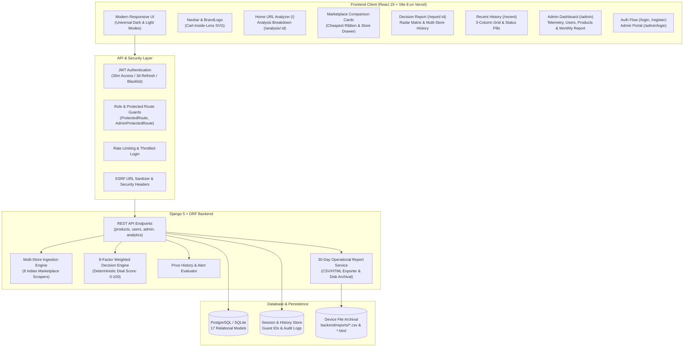

# 🔍 DealLens — AI-Powered Multi-Marketplace Price Comparison & Deal Decision-Support Platform

<div align="center">


**An intelligent, multi-marketplace price discovery, 8-factor deal scoring, and cross-store decision-support system.**

[Live Architecture](#-system-architecture) • [Features](#-key-features) • [Tech Stack](#-technology-stack) • [Quick Start](#-quick-start) • [API Docs](#-complete-rest-api-reference) • [Vercel Deployment](#-vercel-deployment-guide)

</div>

---

## 📌 Project Overview

**DealLens** is a production-grade, full-stack e-commerce decision intelligence platform designed to eliminate buyer hesitation and price fragmentation across Indian online marketplaces.

Traditional price checkers only compare raw prices on a single store. **DealLens** goes beyond simple numbers: it ingests real-time product links across **8 major Indian e-commerce platforms**, executes an **8-factor weighted deal decision algorithm**, compares cross-store alternatives through interactive **Marketplace Comparison Cards**, highlights the cheapest store, provides one-click redirects to official merchant stores, and delivers an explainable **Decision Report** complete with multi-store price history, radar trade-off charts, and transparent pros/cons.

In addition, DealLens equips platform administrators with an **Admin Portal** featuring live telemetry, an interactive **User Activity Inspector** (wishlists & alerts), and an automated **30-Day / Monthly Operational Report** with automated device file archiving (`.csv` and `.html` / PDF).

Developed as a **BCA Final Year Project** by **Punit Kumar**.

---

## 🚀 Key Features

### 🛒 1. 8-Marketplace Real-Time Extraction
- **Supported Platforms:** Amazon India, Flipkart, Myntra, AJIO, Meesho, Croma, Reliance Digital, and Tata CLiQ.
- Universal scraper architecture with schema parsing, metadata fallback, currency normalization, stock availability detection, and broken image resolution.

### 🧠 2. 8-Factor Explainable Deal Decision Engine
- Deterministic, explainable 0–100 **Deal Score** calculation based on 8 weighted consumer dimensions:
  1. **Price Advantage (35%)** — Variance compared to market average and historical low.
  2. **Consumer Rating (15%)** — Verified customer satisfaction score.
  3. **Review Confidence & Volume (10%)** — Statistical significance of review volume.
  4. **Active Offers & Coupons (10%)** — Instant bank discounts and checkout savings.
  5. **Delivery & Fulfillment (10%)** — Shipping speed and logistics reliability.
  6. **Warranty & Return Policy (10%)** — Protection period and replacement window.
  7. **Seller Trust Score (5%)** — Merchant verification and fulfillment history.
  8. **Price Freshness (5%)** — Recency of scraped price data.
- Generates clear **Pros, Cons, and Buying Recommendations** without slow or hallucinating third-party LLM dependencies.

### 💳 3. Interactive Marketplace Comparison Cards
- **Cheapest Store Highlight:** The lowest-priced store is prominently highlighted with an animated green gradient border, glowing pulse, and a shimmer badge (`🏆 CHEAPEST PRICE • SAVE UP TO ₹X`).
- **Deep-Dive Store Drawer:** Clicking on any marketplace card expands a detailed breakdown panel displaying:
  - Official marketplace domain (e.g. `amazon.in`, `flipkart.com`, `croma.com`).
  - Net effective price after coupons with MRP savings.
  - Delivery timeframes, stock availability, manufacturer warranty, and return policies.
  - Multi-criteria score progress bars (`Price Value`, `Customer Rating`, `Delivery Speed`, `Discount & Coupon`, `Store Reliability`).
- **Official Store Redirection:** One-click `"Buy on <Platform>"` button redirects directly to the merchant's official product page.
- **Selective Availability Summary:** Clear indicator displaying which marketplaces carry the item and which do not.

### 📊 4. Comprehensive Decision Report (`/report/:id`)
- **Executive Deal Breakdown:** Best marketplace recommendation with total potential savings and algorithmic verdict.
- **Radar Trade-Off Matrix:** Multi-dimensional visualization across Rating, Price, Delivery, Seller Trust, and Warranty.
- **Cross-Platform Price History:** 30-day zigzag price trends tracked across **all competing platforms**, not just Amazon.
- **Printable Report:** Optimized printer styling for saving or exporting comparison reports as PDF.

### 📅 5. Automated 30-Day / Monthly Operational Report (Admin Only)
- **Automated Monthly Ingestion Audit:** Aggregates 30-day platform performance, total product ingestions, active users, wishlist saves, target price alerts, and platform distribution.
- **Device File Archival:** Automatically saves generated reports directly to the host device disk under `backend/reports/` (`.csv` and `.html` formats) with unique report IDs and timestamps.
- **Dual Export Modes:**
  - **Download CSV:** Instant spreadsheet download for Excel or Google Sheets analysis (`/api/users/monthly-report/?download=csv`).
  - **Print / PDF Report:** Styled HTML document ready for one-click browser printing or PDF archival (`/api/users/monthly-report/?download=html`).

### 🛡️ 6. Dedicated Admin Portal & Live Telemetry (`/admin/login` & `/admin`)
- **Strict Role Isolation:** Regular shoppers authenticate via consumer login (`/login`); platform administrators authenticate through a dedicated Admin Portal (`/admin/login`).
- **Live Scraping Telemetry Log:** 4 live KPI cards (Total Scrapes, Amazon Ingestion, Cross-Market Alternatives, Unique Shoppers), searchable telemetry feed, and server-side pagination.
- **User Activity Inspector:** Administrators can click on any user in the Users table to instantly inspect their **Saved Wishlist** and **Active Price Drop Alerts** with tabbed filters.
- **User Access & Role Controls:** Superuser management, staff promotion/demotion, and instant account activation toggles.
- **Product Catalog & Offers Registry:** Catalog search, deletion, live store prices, and discount inspection.

### 🕒 7. Recent Analyses & Telemetry Log (`/recent`)
- **Responsive 3-Column Display:** Adaptive grid with full-width container (`max-width: 1200px`) preventing row squishing.
- **Tab Filtering:** Instant switching between **All Recent**, **Recently Analyzed**, and **Recently Viewed** items.
- **Deal Score Tags:** Color-coded badges (Emerald: 75+, Amber: 50–74, Rose: <50) with strike-through original MRP.
- **Quick Actions:** Direct shortcuts to deep-dive AI Deal Breakdown (`/analysis/:id`) and Multi-Store Decision Report (`/report/:id`).

### 🔔 8. Price Alerts & Dual-Mode Watchlist
- **Price Alerts (`/alerts`):** Set custom target price thresholds; the system flags when live platform prices fall below the threshold.
- **Dual-Mode Watchlist (`/wishlist`):** Works for unregistered guests via browser session tracking (`X-Guest-ID`), seamlessly linking to user accounts upon registration or login.

### 🎨 9. Full-Frontend Motion & Universal High-Contrast Themes
- **Fluid Motion System:** Staggered panel cascades, route transitions, card hover sheens, button tactile physics, and modal popups (with `prefers-reduced-motion` compliance).
- **Universal Light & Dark Mode:** Semantic CSS surface variable system (`--bg-surface`, `--bg-subtle-surface`, `--bg-banner-gradient`, `--bg-detail-gradient`) ensuring 100% WCAG-compliant contrast across banners, tables, forms, and charts.

---

## 🏛️ System Architecture



---

## 💻 Technology Stack

| Layer | Technologies & Libraries | Purpose |
| :--- | :--- | :--- |
| **Frontend Framework** | **React 19.2.8**, **Vite 8.2.0** | High-performance single page application with modern hooks and fast HMR |
| **Hosting & CDN** | **Vercel** (`vercel.json` SPA Rewrites) | Global edge deployment, automated CI/CD, and fast asset caching |
| **Routing** | **React Router DOM 7.18.3** | Client-side routing, protected routes, and isolated admin sub-trees |
| **Data Visualization** | **Recharts 3.10.1** | Radar charts, bar comparisons, and multi-store historical price curves |
| **Styling & Motion** | Custom CSS Variables, Keyframes, **Lucide React 1.39.0** | WCAG Dark/Light themes, card sheens, micro-interactions |
| **Notifications** | **React Hot Toast 2.6.0** | Non-blocking user feedback and validation toasts |
| **Backend Framework** | **Python 3.12+**, **Django 5.0.7**, **Django REST Framework 3.17.1** | Scalable REST API architecture and database ORM |
| **Authentication** | **SimpleJWT 5.5.1** | JWT access/refresh token rotation, claims, and token blacklisting |
| **Database** | **PostgreSQL** (Production: `DealLens_db`) / **SQLite** (Development) | Relational storage across 17 structured domain models |
| **Scraping & Parsing** | **BeautifulSoup4 4.15.0**, **Requests 2.34.2**, **Playwright** | Multi-store HTML extraction, schema parsing, and DOM fallback |
| **Reporting & Archival**| **CSV / HTML Exporter** (`backend/users/report_service.py`) | 30-day operational report generation and local disk file archival |
| **Security & Middleware**| **Django-CORS-Headers**, **WhiteNoise 6.9.0**, Rate-Limiting | CORS isolation, asset compression, SSRF protection |
| **Testing & Quality** | **Django TestCase** (133 Tests), **ESLint 10.8** | Integration, unit, and frontend lint verification |

---

## 📁 Monorepo Layout

```text
DealLens/
├── backend/                             # Django 5 + DRF Backend
│   ├── config/                          # Project settings, root urls, WSGI/ASGI
│   ├── products/                        # Core products, analysis, offers, scrapers
│   │   ├── services/                    # AI analysis, extraction, comparison engines
│   │   │   ├── ai_analysis.py           # 8-factor weighted deal decision algorithm
│   │   │   ├── comparison.py            # Cross-platform offer normalizer
│   │   │   ├── extraction.py            # Multi-marketplace URL parsers
│   │   │   └── ssrf_protection.py       # URL validation and private IP blocking
│   │   ├── management/commands/         # seed_demo_products, fetch_images
│   │   ├── models.py                    # 17 Relational Django models
│   │   ├── serializers.py               # Serializers (URLAnalysis, Product, Offer, etc.)
│   │   ├── views.py                     # API views (Catalog, Recent, Admin Telemetry)
│   │   └── tests.py                     # Product & extraction test suite
│   ├── reports/                         # Automated 30-day operational report disk archive (.csv, .html)
│   ├── users/                           # User management, auth, price alerts, reports
│   │   ├── models.py                    # Custom user profiles & PriceAlert models
│   │   ├── report_service.py            # 30-day operational report generator & disk storage
│   │   ├── views.py                     # Auth, profile, admin stats, monthly reports, user activity
│   │   └── tests.py                     # Auth & security test suite
│   ├── requirements.txt                 # Pinned Python dependencies
│   ├── .env.example                     # Backend environment template
│   └── Dockerfile                       # Container definition for backend
├── frontend/                            # React 19 + Vite 8 Single Page App
│   ├── src/
│   │   ├── api/                         # Axios instance with JWT interceptors (deallens_* tokens)
│   │   ├── components/                  # BrandLogo, MarketplaceComparisonCards, AnalysisResult, Charts
│   │   │   ├── BrandLogo.jsx            # Custom Cart-Inside-Lens SVG brand emblem
│   │   │   ├── MarketplaceComparisonCards.jsx # Card-based comparison matrix & inspection drawer
│   │   │   ├── AnalysisResult.jsx       # AI deal recommendation & factor summary
│   │   │   ├── PriceHistoryChart.jsx    # Multi-store price movement line chart
│   │   │   └── Navbar.jsx / Footer.jsx  # Universal navigation & responsive footer
│   │   ├── context/                     # AuthContext (sessions), ThemeContext (dark/light)
│   │   ├── pages/
│   │   │   ├── Home.jsx                 # Analyzer hero, featured deals, benefits
│   │   │   ├── AnalysisPage.jsx         # Live URL scraping breakdown & offer ranks
│   │   │   ├── DecisionReport.jsx       # Multi-store decision matrix & radar charts
│   │   │   ├── Recent.jsx               # 3-Column recent history & telemetry
│   │   │   ├── ProductDetail.jsx        # Specifications, reviews, historical trends
│   │   │   ├── Wishlist.jsx             # Dual-mode user & guest watchlist
│   │   │   ├── Alerts.jsx               # Custom target price alert tracker
│   │   │   ├── Login.jsx                # Consumer eCommerce login
│   │   │   ├── Register.jsx             # Account registration
│   │   │   ├── Profile.jsx              # User credentials & account activity
│   │   │   ├── AdminLogin.jsx           # Dedicated Admin Portal login
│   │   │   ├── Admin.jsx                # Admin Dashboard (Telemetry, Monthly Report, Users, Products)
│   │   │   ├── ForgotPassword.jsx       # Recovery flow with token reset
│   │   │   └── NotFound.jsx             # Custom 404 page
│   │   ├── utils/                       # Image fallbacks, platform color palettes
│   │   ├── App.jsx                      # App router & global toast configuration
│   │   ├── App.css                      # Global UI design tokens, animations & CSS variables
│   │   └── main.jsx                     # Vite React DOM entrypoint
│   ├── vercel.json                      # Vercel configuration (SPA rewrites, headers)
│   ├── package.json                     # Pinned Node dependencies & scripts
│   ├── vite.config.js                   # Vite bundler configuration
│   └── Dockerfile                       # Container definition for frontend
├── docs/                                # Final Year Project documentation
│   ├── DealLens_BCA_Documentation.docx  # Comprehensive BCA Project Documentation
│   └── DealLens_BCA_Project_Report.docx # Formatted BCA Final Project Report
├── vercel.json                          # Monorepo root Vercel configuration
├── docker-compose.yml                   # Orchestration (DB + Backend + Frontend)
└── README.md                            # Comprehensive project documentation
```

---

## ⚡ Quick Start

### Prerequisites
- **Python:** 3.12 or newer
- **Node.js:** 20 or newer
- **Database:** SQLite (default for development) or PostgreSQL (`DealLens_db`)

---

### Option A: Local Development Setup

#### 1. Backend Setup
```bash
# Navigate to the backend directory
cd backend

# Create and activate a virtual environment
python -m venv venv
# On Windows:
.\venv\Scripts\activate
# On Linux/macOS:
source venv/bin/activate

# Install dependencies
pip install -r requirements.txt

# Configure environment variables
cp .env.example .env
# (Default settings run on SQLite out-of-the-box, or set DB_NAME=DealLens_db for PostgreSQL)

# Apply migrations
python manage.py migrate

# Seed catalog with 90+ demo products and 350+ multi-store offers
python manage.py seed_demo_products

# Create superuser for the Admin Portal
python manage.py createsuperuser

# Start Django development server
python manage.py runserver 127.0.0.1:8000
```

> **Backend Health Check:** Visit `http://127.0.0.1:8000/api/health/` → `{"status": "ok", "service": "deallens-api"}`

#### 2. Frontend Setup
```bash
# Navigate to the frontend directory
cd ../frontend

# Install dependencies
npm install

# Start Vite development server
npm run dev
```

> **Application Entry:** Open `http://localhost:5173` in your browser.  
> **Default Admin Credentials (from seed):** `admin` / `Admin@123`

---

### Option B: Docker Compose (One-Click Setup)

```bash
# Copy backend environment file
cp backend/.env.example .env

# Build and start all containers (Postgres, Django API, Vite Frontend)
docker compose up --build
```
- **Frontend:** `http://localhost:5173`
- **Backend API:** `http://localhost:8000/api/health/`

---

## ⚙️ Environment Variables

### Backend (`backend/.env`)

| Variable | Required | Default | Purpose |
| :--- | :---: | :--- | :--- |
| `DJANGO_SECRET_KEY` | **Yes** | `django-insecure-default` | Secret key for cryptographic signing |
| `DJANGO_DEBUG` | No | `True` | Debug mode (`True` for local, `False` for production) |
| `DJANGO_ALLOWED_HOSTS` | No | `localhost,127.0.0.1` | Comma-separated allowed hostnames |
| `DB_NAME` | No | *Empty* | PostgreSQL database name (leave empty to use SQLite, or `DealLens_db`) |
| `DB_USER` | No | *Empty* | PostgreSQL username |
| `DB_PASSWORD` | No | *Empty* | PostgreSQL password |
| `DB_HOST` | No | `localhost` | PostgreSQL host |
| `DB_PORT` | No | `5432` | PostgreSQL port |
| `CORS_ALLOWED_ORIGINS` | No | `http://localhost:5173,http://127.0.0.1:5173` | Allowed frontend origins |

### Frontend (`frontend/.env.development`)

| Variable | Required | Default | Purpose |
| :--- | :---: | :--- | :--- |
| `VITE_API_URL` | No | `http://127.0.0.1:8000/api` | Base URL for REST API calls |

---

## 📡 Complete REST API Reference

### 1. System & Platforms
| Method | Endpoint | Auth | Description |
| :--- | :--- | :---: | :--- |
| `GET` | `/api/health/` | Public | Liveness probe returning service status |
| `GET` | `/api/supported-platforms/` | Public | Lists all 8 supported Indian e-commerce platforms |
| `GET` | `/api/categories/` | Public | Lists catalog product categories |

### 2. Products & Price Analysis
| Method | Endpoint | Auth | Description |
| :--- | :--- | :---: | :--- |
| `POST` | `/api/analyze-url/` | Public | Ingests e-commerce URL, runs 8-factor AI engine, returns best deal |
| `GET` | `/api/analyses/` | Public / Guest | Historical URL analysis records with guest tracking |
| `GET` | `/api/products/` | Public | Paginated product catalog with platform price filters |
| `GET` | `/api/products/:id/` | Public | Product specifications, best offer, and multi-store listing |
| `GET` | `/api/products/:id/history/` | Public | 30-day historical price points across all platforms |

### 3. Recent Ingestion & Browsing History
| Method | Endpoint | Auth | Description |
| :--- | :--- | :---: | :--- |
| `GET` | `/api/recent/?type=all|analyzed|viewed` | Public / Guest | Retrieves user's recent product analyses filtered by status |
| `PUT` | `/api/recent/:id/viewed/` | Public / Guest | Marks a specific analysis record as viewed |
| `DELETE`| `/api/recent/clear/` | JWT / Guest | Clears browsing and telemetry history for the session |

### 4. Watchlist & Price Alerts
| Method | Endpoint | Auth | Description |
| :--- | :--- | :---: | :--- |
| `GET` | `/api/wishlist/` | JWT / Guest | List saved products in watchlist |
| `POST` | `/api/wishlist/` | JWT / Guest | Add product to watchlist |
| `DELETE`| `/api/wishlist/:id/` | JWT / Guest | Remove product from watchlist |
| `GET` | `/api/users/alerts/` | JWT | List active price alerts for authenticated user |
| `POST` | `/api/users/alerts/` | JWT | Create price drop alert with target threshold |
| `DELETE`| `/api/users/alerts/:id/` | JWT | Delete a price alert |

### 5. Authentication & User Profile
| Method | Endpoint | Auth | Description |
| :--- | :--- | :---: | :--- |
| `POST` | `/api/users/register/` | Public | Register new consumer account |
| `POST` | `/api/users/login/` | Public (Throttled) | Authenticate user, returns access & refresh JWTs |
| `POST` | `/api/users/token/refresh/` | Public | Rotate refresh token for a fresh access token |
| `GET` | `/api/users/me/` | JWT | Retrieve current user profile and role |
| `PATCH`| `/api/users/me/` | JWT | Update profile details |
| `POST` | `/api/users/change-password/` | JWT | Update user password |
| `POST` | `/api/users/forgot-password/` | Public | Initiate password reset email/token |
| `POST` | `/api/users/reset-password/` | Public | Confirm password reset using uid and token |

### 6. Administrative Operations (Staff / Superuser)
| Method | Endpoint | Auth | Description |
| :--- | :--- | :---: | :--- |
| `GET` | `/api/users/admin-stats/` | Staff | Ingestion rates, user metrics, and platform telemetry |
| `GET` | `/api/users/monthly-report/` | Staff | Generates 30-day operational report, saves to disk file, returns metrics JSON |
| `GET` | `/api/users/monthly-report/?download=csv` | Staff | Downloads the 30-day operational report as a `.csv` spreadsheet file |
| `GET` | `/api/users/monthly-report/?download=html` | Staff | Downloads printable styled HTML report for PDF export |
| `GET` | `/api/users/:id/activity/` | Staff | Inspects target user's saved wishlist items and active price drop alerts |
| `GET` | `/api/admin/analyses/` | Staff | Paginated analyses telemetry feed with search & platform filters |
| `GET` | `/api/admin/products/` | Staff | Manage catalog products with live pagination and search |
| `DELETE`| `/api/admin/products/:id/` | Staff | Remove product from platform |
| `GET` | `/api/admin/products/:id/offers/`| Staff | Manage store offers linked to a product |
| `GET` | `/api/admin/offers/` | Staff | View and filter all multi-store offers |
| `POST` | `/api/users/:id/promote/` | Superuser | Promote or demote user roles (Staff / Superuser / Active) |

---

## 🧮 8-Factor Decision Scoring Engine

The core value proposition of DealLens is its **deterministic, multi-criteria deal scoring algorithm**. Rather than relying on unreliable black-box LLMs, DealLens uses a mathematically grounded scoring matrix:

$$\text{Deal Score} = \sum_{i=1}^{8} (W_i \times S_i)$$

| Factor ($i$) | Weight ($W_i$) | Evaluation Criteria ($S_i$) |
| :--- | :---: | :--- |
| **Price Advantage** | **35%** | Percentage discount relative to highest competitor price and lowest 30-day recorded price. |
| **Customer Rating** | **15%** | Normalized marketplace star rating (scale 0–100). |
| **Review Confidence** | **10%** | Logarithmic scale of total verified reviews to prevent low-sample skewing. |
| **Offers & Coupons** | **10%** | Instant cashbacks, bank cards, and coupon discount valuation. |
| **Delivery & Shipping** | **10%** | Fulfillment speed (Prime/Assured/Same-day vs. standard 5+ day delivery). |
| **Warranty & Returns** | **10%** | Official manufacturer warranty duration and return policy window. |
| **Seller Trust Score** | **5%** | Official brand store vs. third-party marketplace seller verification. |
| **Data Freshness** | **5%** | Recency penalty for prices older than 12 hours. |

---

## 🧪 Testing & Code Quality

DealLens includes a comprehensive test suite covering API contracts, authentication security, scoring logic, and SSRF prevention.

### Running Backend Tests
```bash
cd backend
python manage.py test products users --verbosity=2
```

**Test Coverage Highlights:**
- **Health & Catalog:** API liveness, catalog pagination, platform filtering, categories.
- **Scraping & Ingestion:** Safe extraction pipelines, error handling, metadata fallbacks.
- **8-Factor Scoring Engine:** Mathematical deal score edge cases, pros/cons generation.
- **Monthly Operational Reporting:** 30-day window aggregation, CSV generation, disk file saving.
- **Watchlist & Alerts:** Guest ID isolation, duplicate prevention, price drop triggers.
- **Security & Auth:** Rate-limited login, JWT refresh rotation, password changes, token blacklisting.
- **Role Isolation:** Staff privilege verification, superuser promotion limits, forbidden admin routes.

### Running Frontend Linter & Build Verification
```bash
cd frontend
# Run ESLint (0 errors, 0 warnings policy)
npm run lint

# Compile production Vite bundle
npm run build
```

---

## 🌐 Vercel Deployment Guide

DealLens is pre-configured for seamless, zero-config deployment on **Vercel** with full client-side routing support (SPA rewrites preventing 404 errors on reload).

### 🚀 1. Deploying the Frontend to Vercel (Recommended)

#### Option A: Via Vercel Web Dashboard (Easiest)
1. **Push your repository** to GitHub, GitLab, or Bitbucket.
2. Log in to [Vercel](https://vercel.com) and click **"Add New Project"** > **"Project"**.
3. **Import** your `DealLens` repository.
4. In the **Configure Project** screen:
   - **Framework Preset:** `Vite`
   - **Root Directory:** Click **Edit** and choose `frontend`
   - **Build Command:** `npm run build` *(pre-configured)*
   - **Output Directory:** `dist` *(pre-configured)*
   - **Install Command:** `npm install` *(pre-configured)*
5. **Environment Variables:**
   - Expand the **Environment Variables** panel and add:
     - `VITE_API_URL` = `https://<your-backend-domain>/api` (your live backend API URL)
6. Click **Deploy**. Vercel will build and assign you a global edge domain (`https://deallens.vercel.app`).

#### Option B: Via Vercel CLI
```bash
# Install Vercel CLI globally
npm i -g vercel

# Deploy directly from frontend directory
cd frontend
vercel --prod
```

---

### 🛠️ 2. Solving Single Page Application (SPA) 404 Errors on Vercel
When deploying React Router apps to Vercel, navigating or refreshing pages like `/recent`, `/report/:id`, `/admin`, or `/login` can cause a `404: NOT_FOUND` error if the hosting server tries to look for static files.

DealLens solves this out-of-the-box with dedicated `vercel.json` configurations in both `frontend/vercel.json` and the repository root:
```json
{
  "framework": "vite",
  "buildCommand": "npm run build",
  "outputDirectory": "dist",
  "rewrites": [
    {
      "source": "/(.*)",
      "destination": "/index.html"
    }
  ],
  "headers": [
    {
      "source": "/assets/(.*)",
      "headers": [
        {
          "key": "Cache-Control",
          "value": "public, max-age=31536000, immutable"
        }
      ]
    }
  ]
}
```

---

### 🔗 3. Connecting the Vercel Frontend to the Backend

1. **Configure CORS in Backend:**  
   In your backend `.env` file, include your Vercel deployment URL:
   ```ini
   CORS_ALLOWED_ORIGINS=https://deallens.vercel.app,https://your-custom-domain.com,http://localhost:5173
   DJANGO_ALLOWED_HOSTS=your-api-domain.com,localhost,127.0.0.1
   ```
2. **Set API URL in Vercel:**  
   Go to **Project Settings > Environment Variables** on Vercel, verify `VITE_API_URL` points to your backend:
   ```ini
   VITE_API_URL=https://your-api-domain.com/api
   ```
3. **Trigger Redeploy:**  
   Push a commit or click **Redeploy** on Vercel to inject the updated environment variable into the build.

---

## 🎓 Academic Project Information

- **Project Title:** DealLens — AI-Powered Multi-Marketplace Price Comparison & Deal Decision-Support Platform
- **Program:** Bachelor of Computer Applications (BCA) — Final Year Project
- **Developer:** Punit Kumar
- **Domain:** Full-Stack Web Development, Data Scraping, E-Commerce Analytics, Decision Intelligence

---

## 📄 License

This project is created for academic and research purposes as a Final Year BCA Capstone Project.  
All product trademarks, logos, and marketplace names (Amazon, Flipkart, etc.) belong to their respective owners.
